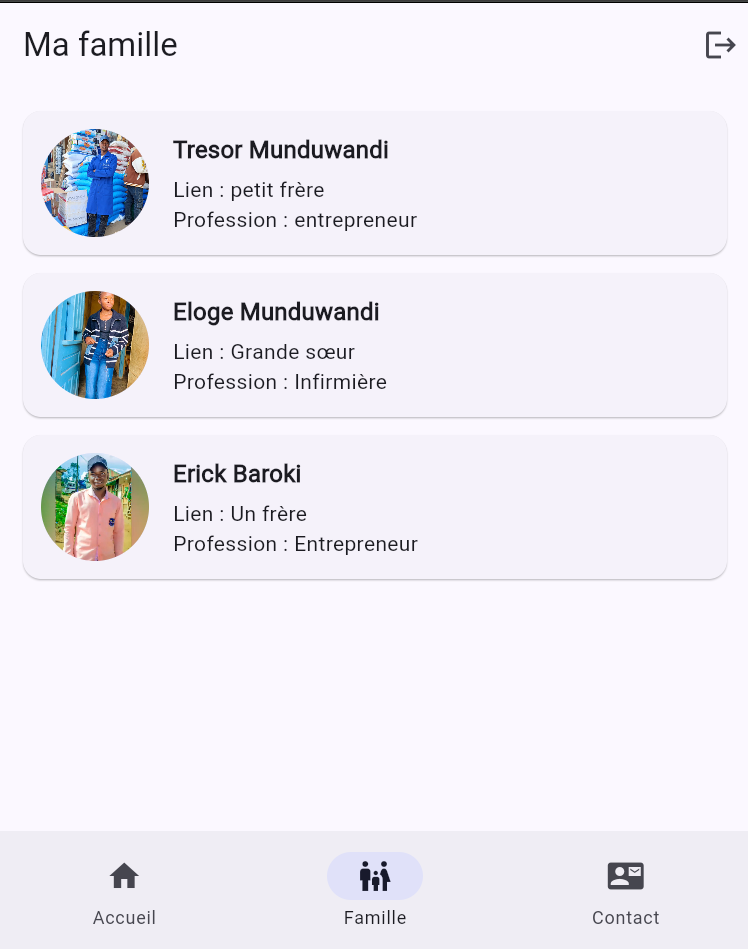

# cv_flutter_grace

Application mobile Flutter de Muhindo Munduwandi Grace présentant mon **CV**, ma **famille** et mes **coordonnées**.

## Fonctionnalités

- Page de **connexion** (identifiant + mot de passe masqué)
- Page **Accueil** : CV complet (photo, profil, formation, expériences, compétences, langues, centres d'intérêt)
- Page **Famille** : membres de la famille (nom, photo, lien de parenté, profession)
- Page **Contact** : téléphone, e-mail, adresse, LinkedIn, GitHub (**liens cliquables**)
- Navigation par **barre de navigation inférieure**

**Identifiants de test :** `admin` / `1234`

## Captures d'écran

| Connexion | Accueil |
|:---:|:---:|
|  |  |

| Famille | Contact |
|:---:|:---:|
|  |  |

## Lancer le projet

```bash
flutter pub get
flutter run
```

## Structure

```
lib/
├── main.dart
├── data/profile_data.dart      # toutes les informations personnelles
├── pages/                      # login, accueil, famille, contact
└── widgets/avatar_image.dart
```
